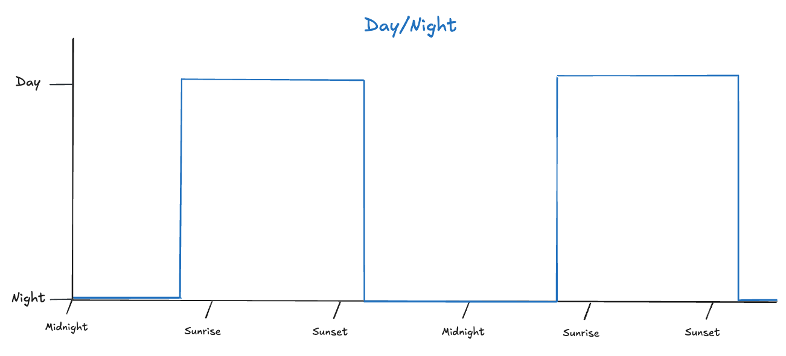
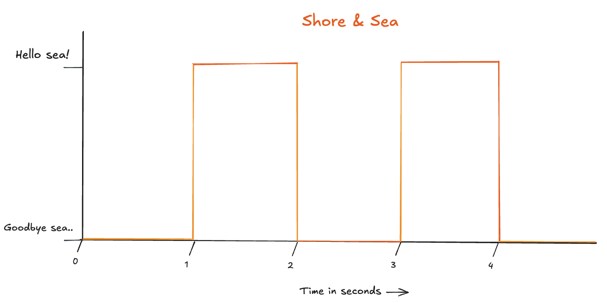
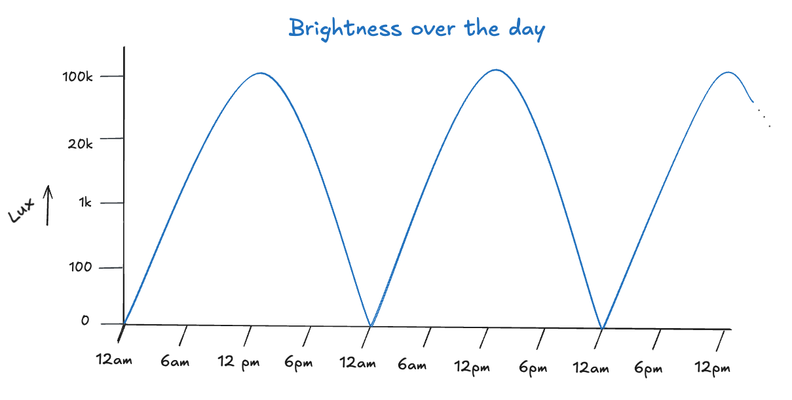
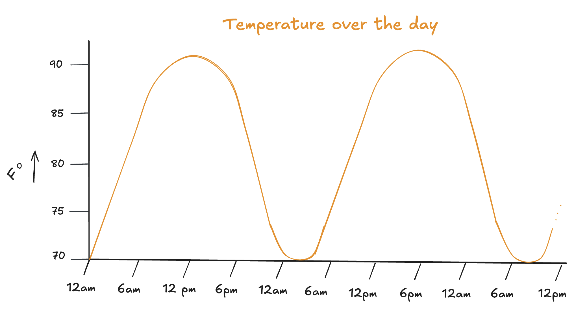
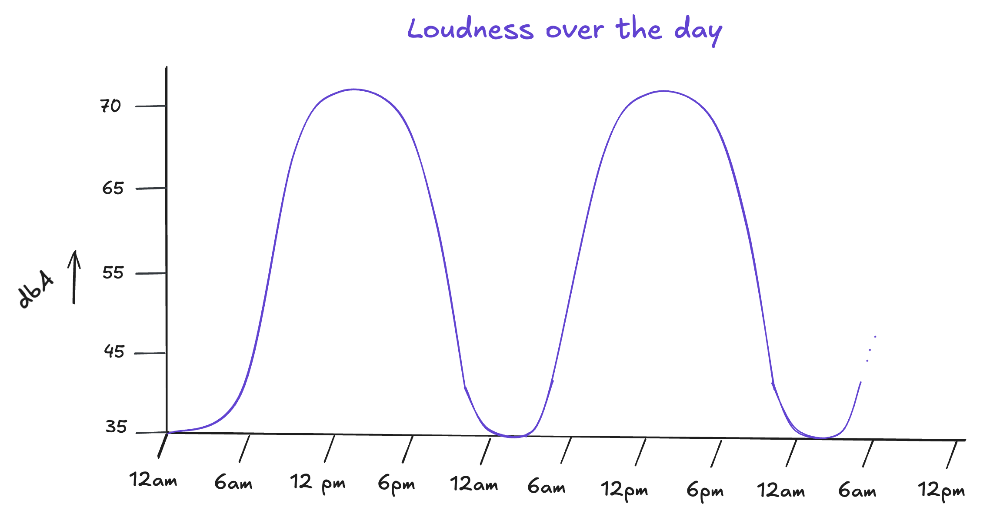

> وَمِن كُلِّ شَىْءٍ خَلَقْنَا زَوْجَيْنِ لَعَلَّكُمْ تَذَكَّرُونَ ٤٩\
> And We have created all things in pairs, so maybe you will reflect.

- Quran - Surah Adh-Dhariyat (51) - Verse 49

---

Light and dark. Adam and Eve. Hot and cold. Life and death.

Seldom in the ages has man found his heart settled enough to see. A thread is thin. Focus and light is needed to find it between two ends. But the Lord of all threads advises more than just its detection. He advises reflection.

---

In the work of The Inventor, there is movement between two ends of a pair. The day moves into the night, the night moves into the day. The warmth of the sun moves into the cold of the night. Life, ever teeming, stills into death.

Maybe the pattern emerges more clearly by the pen. Let's start with the pair of day and night.

Let's say the day begins shortly before sunrise and the night begins shortly after sunset. Were we to symbolize which of the two states of the pair we find ourselves in as time moves forward, we'd be able to see the movement between these two states.

A student of mathematics may be able to recognize this movement by a specific word. An engineer may know it by another. The unwise would give the difference further attention. For those who value time, it's advisable to settle on a unified word - **a wave**.

The unfamiliar may protest: “I thought waves are when the sea comes to the shore and then goes back and then comes again..”. The humble of them may benefit from this thought if they seek whether the language of numbers developed the word from this very sight. For the ancient greetings of the shore and his mistress too have never escaped this movement:

---

> إِنَّ فِى خَلْقِ ٱلسَّمَـٰوَٰتِ وَٱلْأَرْضِ وَٱخْتِلَـٰفِ ٱلَّيْلِ وَٱلنَّهَارِ لَـَٔايَـٰتٍۢ لِّأُو۟لِى ٱلْأَلْبَـٰبِ ١٩٠\
> Indeed, in the creation of the heavens and the earth and the alternation of the day and night there are signs for people of reason.

- Quran - Surah Al-Imran (3) - Verse 190

You may have noticed that the waves above are unnaturally sharp and rectangular, is that truly how they operate in reality? Do we see the day for 12 hours, blink, and all of a sudden find ourselves in the pitch dark of the night?

The answer is no of course. The above waves are binary so we can begin our understanding at the highest level of our simply daily language, where we categorize a lot in a few simple words. There are signs of The Most Loving in that as well, but better saved for another day.

The reality rather is that the observable changes between natural pairs are more gradual the more you pay attention. Let's dive deeper in the pair of day and night and see what elements change gradually between the two. We can start with what we see - brightness.

Lux is a measure of how much light falls on a surface. Though not measured with a photometer, the graph estimate shows a reality closer to the gradual nature of brightness we see throughout our days and nights. Were we to make the points even more precise and physically measure them, we would see the wave in an even more real and beautiful form.

The very light we see alternating before us emerges us in another pair - one of hot and cold.

As opposed to brightness, the waves of the hot and cold of our days, invoke not our sight but the sense of our touch. We find these waves increase and decrease in the range of temperature throughout the seasons. This is a pair and wave as well. On a summer day like the one above, you'll see the range shortens around \~70 to \~90, whereas during the spring or fall, you may find the ranged moved and elongated around \~40 to \~75.

وَجَعَلْنَا نَوْمَكُمْ سُبَاتًۭا ٩ وَجَعَلْنَا ٱلنَّهَارَ مَعَاشًۭا ١١

> And (We) made the night as a cover. And (We) made the day for livelihood.

- Quran - Surah An-Naba (78) - Verses 10-11

Besides sight and touch, the perceptive may also be able to tell that the day usually roars in bustling compared to the quiet of the night.

dbA is A-weighted decibels, which are approximate human hearings.

Perhaps oceans could be written on the pairs and waves that exist within just the day and night. One is in awe of the thought that the source of these constant changes is tirelessly constant Himself. Though we are clearly not.

Till the next meeting between us two, I give you this introduction so we may share in reflection till then.
